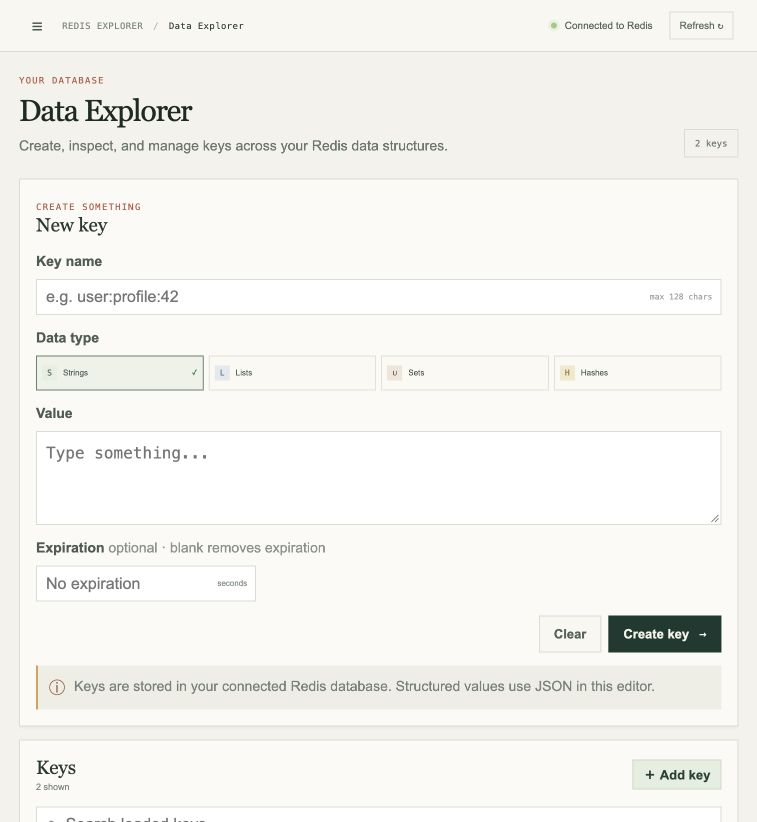
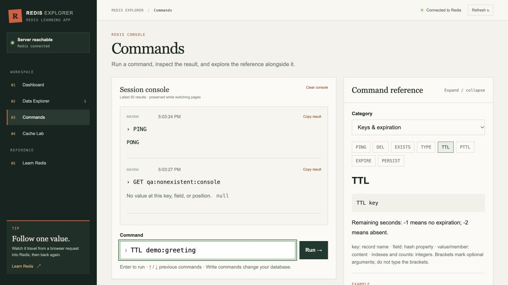
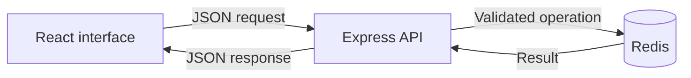

[Live demo](https://redis-explorer-beta.vercel.app/)

# RedisExplorer

RedisExplorer is a web application for learning Redis through direct interaction with a database. Users can manage keys visually, execute Redis commands, and compare cached data with its source. The project demonstrates NoSQL data structures and cache expiration through examples that can be changed and repeated.

The frontend uses React, Vite, and CSS. An Express API handles validation and database requests through the `redis` Node.js client. Redis is the application's NoSQL database.

## User interface

| Page | Purpose |
| --- | --- |
| Dashboard | Displays connection status, key count, recent activity, and cache metrics. |
| Data Explorer | Creates and edits strings, lists, sets, and hashes. Supports expiration, paginated key inspection, and confirmed deletion. |
| Commands | Provides a command console with history, structured results, and a reference for supported commands. |
| Cache Lab | Offers a guided sample or custom JSON source. Users can compare source and cached values, change TTL, and clear the cache. |
| Learn Redis | Presents one topic at a time, with expandable command explanations, playground examples, and official documentation links. |

### Data Explorer



### Commands



## Local setup

Install Node.js 22 or newer and Docker with the Compose plugin. Clone this repository, then install dependencies from its root directory:

```bash
git clone https://github.com/sriram629/RedisExplorer.git
cd RedisExplorer
npm install
npm --prefix backend install
npm --prefix frontend install
```

Create a `.env` file in the repository root with the following local settings:

```dotenv
NODE_ENV=development
PORT=3001
VITE_PORT=5173
REDIS_PORT=6379
REDIS_URL=redis://127.0.0.1:6379
CLIENT_ORIGIN=http://localhost:5173
VITE_API_URL=/api
API_PROXY_TARGET=http://127.0.0.1:3001
CACHE_TTL_SECONDS=60
```

Start Docker, then run:

```bash
npm run dev:local
```

This command starts Redis, waits for its health check, and starts the API and frontend. Open the address printed by Vite; the settings above use `http://localhost:5173`. If a port changes, update the corresponding URLs in `.env` as well.

Environment files are ignored by Git. Each developer creates their own file. Only variables prefixed with `VITE_` are available to frontend code, so database credentials must remain in `REDIS_URL`.

| Command | Purpose |
| --- | --- |
| `npm run dev:local` | Start Redis, the API, and the frontend. |
| `npm run dev` | Start the API and frontend with an existing Redis instance. |
| `npm run build` | Build the frontend into `frontend/dist`. |
| `npm start` | Start the API. |
| `npm test` | Run the backend tests; the Redis integration test requires explicit configuration. |
| `docker compose down` | Stop local Redis and retain its saved data. |

## Database installation and integration

Docker Compose installs Redis from the `redis:7-alpine` image. The container exposes the host port defined by `REDIS_PORT`; Redis itself listens on port 6379 inside the container. Append-only persistence is enabled, and data is stored in the `redis_data` Docker volume. Removing that volume with `docker compose down -v` deletes the saved local data.

The API reads `REDIS_URL` at startup and opens a shared Redis connection. Feature routes receive that client and use service functions for database operations. Requests are validated before they reach Redis, and failures are returned as JSON errors. A remote Redis service can be used by changing `REDIS_URL`.

Redis stores values under keys without relational tables. This project uses the following structures:

| Structure | Example use | Implemented operations |
| --- | --- | --- |
| String | Text, counters, and serialized cache records | Set, get, append, length, multiple reads, increment, and decrement. |
| List | Ordered collections | Push, pop, range, index, length, update, remove, and trim. |
| Set | Unique members | Add, remove, membership, cardinality, random selection, union, intersection, and difference. |
| Hash | Field/value records | Set and read fields, retrieve all fields, delete fields, inspect field names and counts, and numeric increments. |
| Key metadata | Lifetime and type inspection | Scan, existence, type, deletion, expiration, TTL, and persistence. |

Data Explorer implements create, read, update, and delete operations for all four value types. The command console exposes a defined command allowlist. Its reference panel documents supported syntax; administrative and scripting commands are excluded.

Cache Lab stores its sample source and cached copy as separate Redis records. A source update can therefore leave an older cached copy in place until expiration or invalidation. This models cache behavior using teaching data within Redis. Source records and experiment history expire after 24 hours; the cached copy uses the selected TTL. Dashboard cache counters are held in API memory and reset after a server restart.

## Workflow and data flow



During local development, the browser calls `/api` on Vite. Vite forwards the request to `API_PROXY_TARGET`. For separate hosting, `VITE_API_URL` points directly to the deployed API.

A key edit moves from the form to an API route, then to Redis. The response updates the shared React state. A Cache Lab fetch first checks for the cached copy: a hit returns that copy; a miss reads the saved source and creates a cache entry with an expiration. Clearing the cache removes the cached copy and retains the source.

## Project structure

```text
frontend/src/
  pages/          Application screens
  components/     Shared layout and interface components
  hooks/          State and application actions
  store/          React context provider
  services/       HTTP client
  constants/      Configuration, lessons, and command reference
  utils/          Formatting helpers
backend/src/
  routes/         Endpoints grouped by feature
  services/       Redis operations, commands, caching, and metrics
  config/         Environment parsing
  app.js          Express middleware and routing
  redis.js        Redis client
  server.js       Environment loading and server startup
backend/test/     Backend tests
docs/screenshots/ README images
```

## Deployment configuration

Use the same variable names locally and on the hosting platforms. Enter deployed values in the provider settings; do not upload the local `.env` file.

| Variable | Deployment setting |
| --- | --- |
| `NODE_ENV` | Set to `production` on Render. |
| `PORT` | Supplied by Render. |
| `REDIS_URL` | Database connection URL on Render. |
| `CLIENT_ORIGIN` | Exact Vercel origin, with no trailing slash or path. |
| `VITE_API_URL` | Render API address ending in `/api`, set on Vercel before building. |
| `CACHE_TTL_SECONDS` | Default cache TTL in seconds on Render. |
| `VITE_PORT`, `REDIS_PORT`, `API_PROXY_TARGET` | Local development settings; not required for this split deployment. |

Create the Render database in the same region as the API and use its internal connection URL. For the Render Web Service, set **Root Directory** to `backend`, **Build Command** to `npm ci`, **Start Command** to `npm start`, and **Health Check Path** to `/api/health`.

For Vercel, set **Root Directory** to `frontend`, choose **Vite**, use **Install Command** `npm install`, **Build Command** `npm run build`, and **Output Directory** `dist`. Rebuild after changing `VITE_API_URL`. Once both services are ready, the health endpoint should report `connected: true`, and `PING` in Commands should return `PONG`.

Use a dedicated learning database. The application currently shares its database between visitors, has no user authentication, and provides a Delete all action that clears the connected database.
